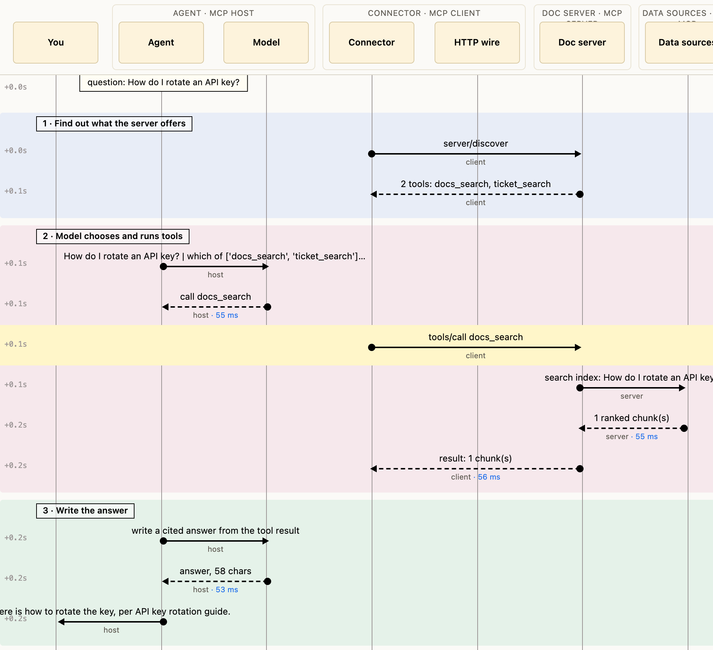
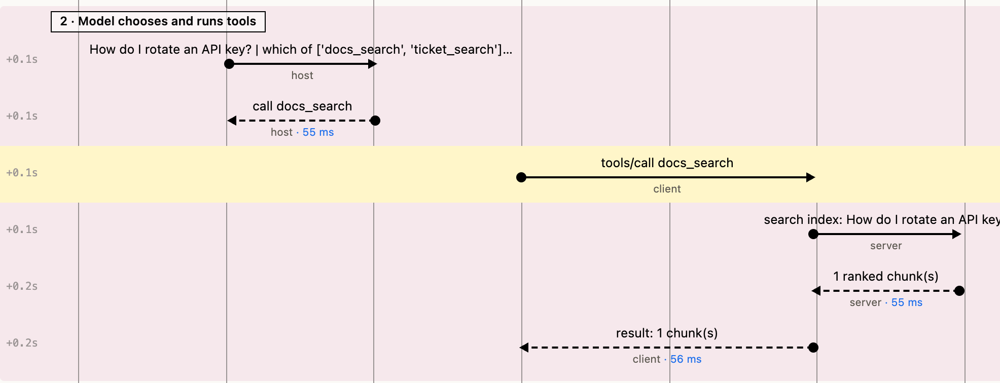
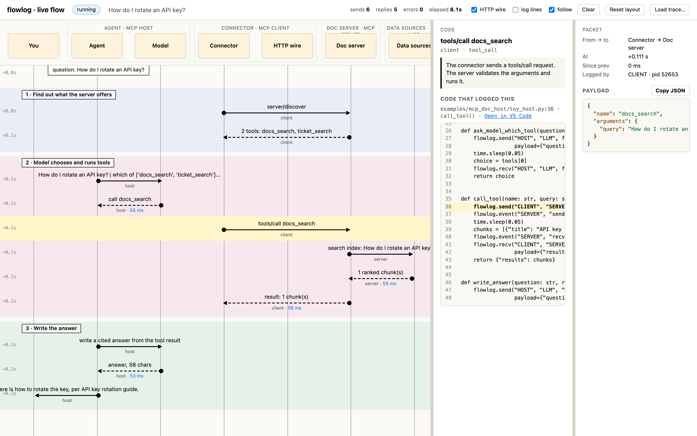

# Flowlog

**See exactly how your processes, agents, and MCP servers talk to each
other, drawn as a live sequence diagram in your browser.**

Flowlog is a small Python library and CLI for local debugging. Drop a few
`send`/`recv` calls into your code, run your script, and watch every
request, reply, and timing appear as arrows between lanes. Click any arrow
to see the line of code that logged it and the full payload it carried.

**Adding and removing it takes two steps:**

1. **Add:** paste [Prompt A](#ai-assistant-auto-instrumentation) into your
   coding assistant (or run [`/instrument-flowlog`](#using-flowlog-with-claude-code)
   in Claude Code). It finds
   the boundaries in your code and inserts the calls for you to review.
2. **Remove:** run with `python -O` and every call disappears (Prompt A
   wraps each one in `if __debug__:` so Python skips them), or strip them
   from the source for good with
   [`strip_flowlog.py`](examples/mcp_doc_host/strip_flowlog.py).


*A real run of the bundled example: a question travels from you to the
agent, the model picks a tool, the connector calls the doc server, and the
answer comes back, grouped into three phases.*


*Close-up of phase 2: solid arrows are calls, dashed arrows are replies,
and each reply shows how long it took.*

### Why not just print statements or logs?

Print statements don't survive across processes, don't show timing, and
don't give you a diagram. A full telemetry logging stack does all that, but
it needs a collector and a backend before you see anything, which is a lot
to set up for one debugging session. Flowlog sits in between: one
append-only trace file and a viewer served by Python's built-in HTTP
server. No collector, no account, no cloud.

## Easy peasy

**1. Add Flowlog calls to your code**, whichever way suits you:
- **Let your coding assistant do it:** paste [Prompt A](#ai-assistant-auto-instrumentation)
- **Claude Code:** run [`/instrument-flowlog`](#using-flowlog-with-claude-code)
- **By hand:** a few lines, see [How it works](#how-it-works)

**2. Run your script and watch the flow:**

```bash
pip install git+https://github.com/IntelligenceLattice/flowlog
flowlog run your_script.py   # starts tracing and opens the viewer in your browser
```

**Just want to see it first?** The bundled example already has the calls in it:

```bash
cd examples/mcp_doc_host
flowlog run --config flowlog.config.json toy_host.py -- "How do I rotate an API key?"
```

## Built for development and demos (not production yet)

Flowlog is built for two jobs: debugging your system on your own machine,
and showing other people how it works. It is not ready to run in
production:

- the viewer has no login: it listens only on `127.0.0.1`, but anything
  running on your machine can open it
- everything goes into a single trace file on one machine, with no rotation
  or retention
- traces from several machines can't be combined
- payloads are written as-is (up to 200,000 characters each), so any secrets
  they contain end up in the trace file

Before you ship, turn it off (`FLOWLOG_TRACE` unset), skip it entirely with
`python -O`, or strip the calls out (see [Switches and flags](#switches-and-flags)).
For monitoring in production, use a dedicated telemetry logging stack.

## How it works

```python
import flowlog

flowlog.send("CLIENT", "SERVER", "tools/call docs_search", kind="tool_call")
result = call_the_actual_thing()
flowlog.recv("CLIENT", "SERVER", f"result: {len(result)} chunks", kind="tool_result")
```

- `send(role, target, text, *, kind="", payload=None)` - an outbound call.
- `recv(role, source, text, *, kind="", payload=None)` - its reply.
- `note(role, text, *, kind="")` - a standalone step.
- `event(role, direction, peer, text, *, kind="")` - trace-only (never
  printed to stdout); for in-process hops or a process whose stdout is
  itself a protocol channel.
- `rule(title="")` - a separator between scenarios.
- `short(value, limit=110)` - compact one-line rendering for log text.
- `capture()` - a context manager that collects emitted lines, for tests.

Roles, kinds, and peers are plain strings you choose - Flowlog has no
built-in vocabulary. Every call is a true no-op (one env-var check, no I/O)
when tracing is off.

With `FLOWLOG_TRACE=<path>` set, every call also appends one JSON object to
that file: role, direction, peer, text, an optional `kind`, the full
`payload`, and the code location that logged it (file, line, function - via
stack-frame introspection, not manual bookkeeping). Multiple processes can
append to the same file safely (one atomic `write()` per line).

## Switches and flags

| Switch | Type | When used | Values | Effect |
|---|---|---|---|---|
| `FLOWLOG_TRACE` | env var | Every day, during development | unset/empty = off; path = on | All trace calls become true no-ops when off |
| `FLOWLOG_ROOT` | env var | Rare - only if auto-detected project root is wrong | absolute path | Overrides repo-root resolution for relative file paths |
| `if __debug__: ...` + `-O`/`PYTHONOPTIMIZE=1` | language mechanism | Once, at production ship time | `-O` flag or env var | CPython strips every guarded block (incl. the lazy `import flowlog`) from bytecode entirely |
| `--trace PATH` | CLI flag | Pick a specific trace file location | file path | Overrides the default temp path |
| `--config PATH` | CLI flag | Use a specific lane/phase config | file path | Overrides `./flowlog.config.json` → built-in default |
| `--port N` | CLI flag | Avoid a conflict, or pin a known port | port, or `0` | `0` auto-selects a free port |
| `--no-browser` | CLI flag | Headless/CI environments | flag | Server still starts; URL printed |
| `--module` | CLI flag | Target is a package, not a script | flag | Runs via `python -m <target>` |
| `--force` | CLI flag (`init`) | Regenerate scaffolding on purpose | flag | Allows overwriting an existing config |

Two different lifecycles, not redundant: `FLOWLOG_TRACE` is the everyday
toggle you flip mid-session; `__debug__`/`-O` is a one-time action at the
moment you ship, after which Flowlog isn't even present in the artifact and
doesn't need to be an installed dependency in production.

## CLI reference

- **`flowlog run <script.py> [-- args]`** - sets `FLOWLOG_TRACE`, starts the
  viewer, opens your browser, runs the target as a subprocess. Flags go
  *before* the target; everything after it (including a bare `--`) passes
  through unchanged. The viewer stays up after the script exits until Ctrl+C;
  pass `--exit` to stop it with the script.
- **`flowlog view [--trace] [--config] [--port]`** - standalone viewer
  against an existing/growing trace file.
- **`flowlog init [DIR] [--force]`** - scans a project and writes a starter
  `flowlog.config.json` plus `FLOWLOG_INSTRUMENTATION_NOTES.md` (candidate
  call sites). Never edits source files.
- **`flowlog doctor`** - runs the same environment checks as `run`/`view`
  with no side effects; prints pass/fail per check.

Environment validation runs before anything starts, with specific messages
for: Python too old, target script missing, trace path unwritable or on a
read-only filesystem, port already in use, invalid config JSON. A failed
browser auto-open (headless environments) is a warning, not an error - the
viewer still runs; open the printed URL manually.

## Capturing HTTP traffic

Opt-in helpers for httpx, requests, and aiohttp - you wire them in
explicitly; Flowlog never monkeypatches anything:

```python
import httpx
from flowlog.hooks.httpx_hooks import build_event_hooks

client = httpx.AsyncClient(event_hooks=build_event_hooks(role="HTTP"))
```

**Capture happens at the plaintext application layer** - on the
request/response *objects* your HTTP client hands to its own hooks, after
it has already parsed a response (TLS already unwrapped it) and before it
sends a request (TLS hasn't wrapped it yet). Flowlog never inspects wire
bytes and cannot decode traffic it isn't handed by the application layer -
wire/packet-level sniffing of encrypted traffic is out of scope by design.
Full detail: [docs/hooks.md](docs/hooks.md).

## The viewer


*The bundled example with the `tools/call docs_search` arrow
selected: the code pane jumps to `toy_host.py:36`, the line that logged it,
and the packet pane shows the exact arguments sent.*

Three resizable panes, all live as events stream in:

- **Flow:** the sequence diagram, one lane per role, grouped into phases.
- **Code:** the source line that logged the selected arrow, with a
  plain-language explanation from your config.
- **Packet:** its full JSON payload, one click to copy.

Drag the dividers to resize. Your layout is saved in the browser, with a
one-click reset. Full detail: [docs/viewer.md](docs/viewer.md).

## Config: lanes, phases, tooltips per project

The viewer has no built-in vocabulary - `flowlog.config.json` maps your
own role/kind strings to lane layout, phase bands, reply-pairing, and
tooltips. Unmapped values never error, they just render generically. Full
schema: [docs/config-schema.md](docs/config-schema.md). See
`examples/mcp_doc_host/flowlog.config.json` for a worked example.

## AI-assistant auto-instrumentation

No installed command needed - paste one of these into any chat-based
coding assistant:

**Prompt A - full instrumentation (the assistant writes the calls; you review the diff):**
```
Instrument <PATH> with flowlog tracing, following these rules exactly:
1. Check whether `flowlog` is already a dependency of this project (search
   pyproject.toml/requirements.txt or try `import flowlog`). If not installed,
   add it using this project's own existing dependency manager (uv add / poetry
   add / pip install + requirements.txt entry), installing it
   from `git+https://github.com/IntelligenceLattice/flowlog` (the PyPI package named `flowlog` is an unrelated project) - add it as a dev-only dependency if the project separates
   dev/prod deps.
2. Scan <PATH> (a file, folder, or the whole repo if no path given) for logical
   boundaries: function entry/exit at process or network edges, request handlers,
   tool/queue dispatch points. Skip plain internal helper functions - only
   instrument places where something crosses a boundary worth seeing on a flow
   diagram.
3. For each boundary, insert the matching flowlog call:
   - flowlog.send(role, target, text, kind=..., payload=...) for an outbound call
   - flowlog.recv(role, source, text, kind=..., payload=...) for its reply
   - flowlog.note(role, text, kind=...) for a standalone step
   - flowlog.event(role, direction, peer, text, kind=...) for an internal hop
   Use short, consistent `kind` strings so a request and its reply can be paired
   later (e.g. "tool_call" / "tool_result"). Pick role names that match this
   project's own component names - ask me if it's ambiguous, don't guess.
4. Wrap every inserted call as `if __debug__: flowlog.send(...)`, importing
   flowlog lazily inside that guard, not at the top of the file - this lets
   production builds strip flowlog entirely via `python -O`.
5. Create or update flowlog.config.json at the project root: one lane per role
   used, and (if you can infer sensible labels) a phases/kind_phase/pairs/explain
   mapping for the kind strings you chose.
6. Don't wrap flowlog calls in extra try/except - they're already safe no-ops.
7. Show me the full diff before I decide whether to accept it. Don't commit
   anything.
```

**Prompt B - boundary discovery only (no edits, review first):**
```
Scan <PATH> (a file, folder, or the whole repo if no path given) and list every
function/call site that is a logical instrumentation boundary for flow tracing:
function entry/exit at process or network edges, request handlers, tool/queue
dispatch points. Do NOT skip this to "every function" - only report places where
something genuinely crosses a boundary worth seeing on a sequence diagram.

For each one, report:
- file:line and function name
- why it's a boundary (one line)
- suggested role name for its component
- suggested flowlog call type (send/recv/note/event) and a short `kind` string

Output this as a table. Do not modify any files. I'll review the list and ask
you to instrument a subset of it next.
```

Prefer an installed command? See [Using Flowlog with Claude Code](#using-flowlog-with-claude-code)
below. GitHub Copilot and Codex equivalents (repo instructions and a prompt
file) are in [ai-assistants/github-copilot/](ai-assistants/github-copilot/)
and [ai-assistants/codex/](ai-assistants/codex/). All of them follow the
same steps, written out in [docs/instrumentation-conventions.md](docs/instrumentation-conventions.md).

## Using Flowlog with Claude Code

Flowlog ships a ready-made Claude Code slash command,
`/instrument-flowlog`. Install it once and Claude Code does the
instrumenting for you, from install to diff.

**1. Install the command.** From a clone of this repo, copy the command
file into your project:

```bash
mkdir -p your-project/.claude/commands
cp ai-assistants/claude-code/instrument-flowlog.md your-project/.claude/commands/
```

To use it in every project instead, copy it to `~/.claude/commands/`.
Commit `.claude/commands/instrument-flowlog.md` if you want your whole team
to have it.

**2. Run it.** Open Claude Code in your project and type:

```
/instrument-flowlog src/
```

Pass a file, a folder, or nothing for the whole repo. Claude Code will:

- install `flowlog` with your project's own tool (uv, poetry, or pip),
  as a dev-only dependency where possible
- find the places where your code crosses a boundary: network calls,
  request handlers, tool and queue dispatch (not every function)
- insert `flowlog.send` / `recv` / `note` calls, each wrapped in
  `if __debug__:` so `python -O` removes them
- ask you what to call a component when the name isn't obvious
- write a `flowlog.config.json` with one lane per component
- show you the full diff and stop. It never commits.

**3. Watch it run.**

```bash
flowlog run your_script.py
```

Your browser opens on the live diagram.

**4. Let Claude Code read the trace too.** The trace is a plain JSONL file,
so Claude Code can debug from it directly. Pick a path you can hand over:

```bash
flowlog run --trace flowlog-trace.jsonl your_script.py
```

Then ask something like *"Read flowlog-trace.jsonl and tell me why the
second tool call takes 3 seconds."* Every line records who called whom,
when, the payload, and the file and line that logged it, so Claude Code can
jump straight to the code. Add `flowlog-trace.jsonl` to `.gitignore`: it
contains full payloads.

**5. Remove it when you're done.** Run with `python -O`, or ask Claude Code
to strip the calls with
[`strip_flowlog.py`](examples/mcp_doc_host/strip_flowlog.py)
(`python examples/mcp_doc_host/strip_flowlog.py src/` from a clone of this
repo; add `--check` to preview without changing anything).

## `flowlog init`

```bash
flowlog init path/to/project
```

Scans for candidate instrumentation points by name heuristics and writes a
starter `flowlog.config.json` plus `FLOWLOG_INSTRUMENTATION_NOTES.md`.
Never edits source files - that's the AI-assistant prompts' job, under
review.

## Feature support

| Feature | Status |
|---|---|
| Manual `send/recv/note/event/rule` API | Supported |
| JSONL trace file, multi-process safe append | Supported |
| Browser sequence-diagram viewer (live SSE tail) | Supported |
| Config-driven lanes/phases/explain per project | Supported |
| httpx/requests/aiohttp opt-in capture helpers | Supported |
| CLI: `run` / `view` / `init` / `doctor` | Supported |
| 3-pane resizable viewer (flow/code/packet) | Supported |
| Off switch via env var (true no-op) | Supported |
| AI-assistant slash-command / prompt scaffolding | Supported |
| Auto-instrumenting decorators | Not supported (deliberately out of scope; may revisit) |
| Wire/packet-level (TLS-encrypted) traffic capture | Not supported (by design - see Capturing HTTP traffic) |
| Distributed/multi-host trace aggregation | Not supported |
| Persistent storage / database backend | Not supported (flat JSONL only, by design) |
| Auth / multi-user viewer | Not supported (local single-user tool) |
| Windows-native CI verification | Untested (should work - stdlib only - but not CI-checked yet) |

This table is a living doc - PRs that add or remove a capability update it
(see `CONTRIBUTING.md`).

## Examples

[examples/mcp_doc_host/](examples/mcp_doc_host/) - a standalone toy script
plus a real-world `flowlog.config.json`, runnable with no MCP SDK or cloud
dependencies.

## Contributing

Flowlog is offered as open source and explicitly invites multi-language
ports (Node/TS, Go, Rust are candidates - see `ROADMAP.md`) and feature
contributions. See `CONTRIBUTING.md`, `CODE_OF_CONDUCT.md`, and the issue
templates.

## License

MIT
